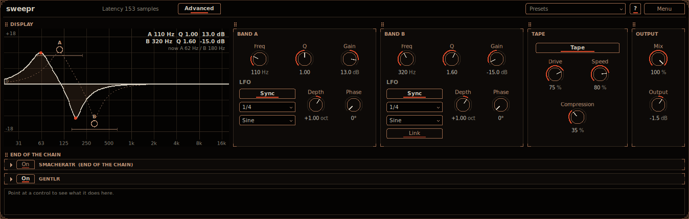

# sweepr

sweepr is a two-band EQ whose two bands move. Each band is a bell (a boost or a cut around its
frequency), and each has an LFO that sweeps that frequency up and down, in time with the song or free.
After the two bands the sound goes through a tape stage: compression, drive into a tape-style saturator,
the low head bump, softer highs and a little wow, all following the tape **Speed**. Put it on a bass and
a boost and a cut roll over the harmonics with the beat; the curve on the display moves with them. Install
instructions are in the [top-level README](../../README.md).



## How to use it

1. Put sweepr on a bass, a pad or a loop and press play. A new instance is already moving: band A boosts
   13 dB at 110 Hz, band B cuts 15 dB at 320 Hz, and each LFO sweeps its band an octave up and down
   every beat (1/4, Sine), into tape.
2. Drag the **A** and **B** handles on the display: sideways for the frequency, up and down for the
   gain; the mouse wheel over a handle (or Alt and drag) for Q. The bright line is the curve now, the
   dashed line the curve at the settings, the bar under each handle how far its LFO sweeps.
3. Set each band's LFO in its panel: **Sync** on for a note value (**1/32** to **4 Bars**, triplets and
   dotted ones too), off for a free **Rate** in Hz; **Shape**; **Depth** (how many octaves up and down;
   0 keeps the band still); **Phase**. **Link** in band B makes B follow A's LFO, offset by B's
   **Phase** (180: against A).
4. Shape the tape: **Drive** for more saturation (the level stays about the same), **Speed** lower for
   a darker, warmer, wobblier tape, **Compression** for more squash. **Tape** off leaves the moving EQ
   alone.
5. **Mix** blends in the dry sound, **Output** sets the level.

Point at any control for help in the info box at the bottom (**?** also switches on hover tooltips).

## The display

The curve of the two bands from 20 Hz to 20 kHz, +18 to -18 dB, on the grid of a classic two-band EQ
screen (31 Hz to 16 kHz in octaves):

- the bright line over a faint fill: the curve now, with each band where its LFO has swept it, and a
  cinnabar dot on each band's frequency now;
- the dashed line: the curve at the knobs' settings (while the bands are swept away from it);
- the **A** and **B** handles: each band's **Freq** and **Gain**, to drag;
- the bar under a handle: how far its LFO sweeps (**Depth** octaves each way from **Freq**);
- at the top right: both bands' settings, and while audio plays where they are now.

| On a handle | What it does |
|---|---|
| drag sideways | **Freq** |
| drag up and down | **Gain** |
| Alt and drag up and down | **Q** |
| mouse wheel | **Q** |
| Shift and drag | fine steps |
| double-click or right click | the band back to its default **Freq**, **Q** and **Gain** |

The curve follows the LFOs while the host runs sweepr (also during silence: the LFOs keep moving), and
shows the settings when it does not.

## Controls

**BAND A** and **BAND B** (each the same, B with **Link**)

- **Freq** (20 Hz to 20 kHz; A 110 Hz, B 320 Hz by default): the bell's centre, where the LFO sweeps from.
- **Q** (0.1 to 10; A 1.00, B 1.60): the bell's width. Low Q is broad and gentle, high Q a narrow peak or notch.
- **Gain** (-18 to +18 dB; A +13 dB, B -15 dB): how far the bell boosts or cuts.
- **LFO**:
  - **Sync** (on by default): on, the LFO's length is a note value locked to the song position; off,
    it runs free at **Rate**.
  - the note value (shown with **Sync** on; **1/32**, **1/16T**, **1/16**, **1/16D**, ... **1/2D**,
    **1 Bar**, **2 Bars**, **4 Bars**; **1/4** by default): one LFO cycle. T is a triplet, D dotted; a
    bar is four beats.
  - **Rate** (shown with **Sync** off; 0.01 to 40 Hz, 1 Hz by default): the free LFO's rate.
  - **Shape** (**Sine** by default): **Sine**, **Triangle**, **Saw Up**, **Saw Down**, **Square**,
    **Random** (a new value each cycle) or **Smooth Random** (gliding from one random value to the next).
  - **Depth** (-4 to +4 octaves, +1 by default): how far the LFO sweeps **Freq**, up and down. Negative
    sweeps the other way round (down where a positive one goes up); 0 keeps the band still.
  - **Phase** (0 to 360 degrees, 0 by default): where in its cycle the LFO is at the start (synced: its
    offset from the beat).
- **Link** (band B, off by default): B's LFO follows A's: A's **Sync**, note value or **Rate** and
  **Shape**, with B's **Phase** as the offset from A (180: B moves against A) and B's own **Depth**.
  B's own LFO settings are dimmed while it is on.

**TAPE**

- **Tape** (on by default): the tape stage after the two bands. Switching it fades over 10 ms.
- **Drive** (0 to 100 %, 75 % by default): how hard the bands drive the tape, from clean to thick and
  squashed. The stage makes up for the drive, so the level stays about the same: turn it by ear.
- **Speed** (0 to 100 %, 80 % by default): the tape speed. Lower is darker, with softer highs, a bigger
  head bump lower down and more wow; higher is brighter and tighter.
- **Compression** (0 to 100 %, 35 % by default): how much the tape squashes the sound before it
  saturates.

**OUTPUT**

- **Mix** (100 % by default): the effect against the untouched input, kept in time with each other (no
  comb filtering).
- **Output** (-24 to +12 dB, -1.5 dB by default): the overall level. At the defaults a bass at a typical
  level (around -18 dBFS RMS) comes out about as loud as it went in.

**smacheratr** (bottom panel): the saturator every plug-in here ends with. In sweepr it starts **off**,
since the tape stage is the saturator; switch it on for more (its gentlr is on, ready). See
[smacheratr](../smacheratr/README.md#at-the-end-of-the-other-plug-ins).

The **Basic** page has the display, **A Gain**, **B Gain**, **A Depth**, **B Depth**, **Drive**, **Mix**
and **Output**; **Advanced** shows everything.

## How it works

```
input -> 4x up -> bell A -> bell B -> tape: compression, pre-emphasis, drive, saturator, de-emphasis
      -> 4x down -> head bump, high roll-off, wow -> Mix (with the input, delayed as much) -> Output
      -> smacheratr (off by default)
```

**The bells.** Each band is the classic constant-Q bell (the gain narrows a boost and widens a cut, the
same both ways) built as a trapezoidal state-variable filter. It runs at four times the sample rate, so
its shape matches the analog bell up to 20 kHz, with no squeezing near the top of the spectrum, and its
coefficients are worked out again for every sample from the swept frequency. That filter keeps a valid
state whatever its coefficients do, so even a 40 Hz **Square** sweeping four octaves neither zippers nor
clicks. The LFO's movement glides over 2 ms, so a **Square** or **Random** step sweeps quickly rather than
jumping. **Freq**, **Q** and **Gain** glide over 20 ms when you turn them.

**The LFOs.** Synced, an LFO's position is the song position in beats divided by the note value, plus
**Phase**: it never restarts, and playing from any point of the song sounds exactly the same as getting
there from the start. The random shapes take their values from the cycle's number, so they repeat with
the song too. With the host stopped, a synced LFO runs on at the last tempo from where it was. Free, an
LFO runs at **Rate** from the moment playback (or the plug-in) starts.

**The tape stage.** At four times the sample rate:

- a compressor on both channels together (the louder sets the gain of both), its squash set by
  **Compression**;
- a +6 dB high shelf above 3 kHz before the curve and the exact opposite after it: the highs are driven
  harder, so they saturate sooner and come back softer;
- **Drive** (-6 to +24 dB into the curve) into a soft, slightly asymmetric curve (a little even-harmonic
  warmth), with a memory like tape's magnetisation: the output follows the curve at a rate that grows
  with how fast the input moves, so it traces a loop that depends on the level rather than a fixed line;
  the curve is anti-aliased (its antiderivative), so with the oversampling a 7 kHz sine at -6 dBFS and
  full **Drive** leaves no fold-back above -58 dB;
- a makeup gain worked out from **Drive** and **Compression** so a sine at about -15 dBFS comes out as
  loud as it went in.

Then, at the normal rate:

- the head bump: a bell from 30 Hz (+4.5 dB) at **Speed** 0 to 100 Hz (+1.5 dB) at 100 %, with a
  small dip above it;
- a 12 dB per octave roll-off from 6 kHz at **Speed** 0 to 22 kHz at 100 %;
- a 10 Hz DC blocker;
- wow and flutter: a gently moving delay (0.55 and 0.13 Hz wow, 6.5 Hz flutter), none at **Speed** 100 %
  and about 0.2 % of pitch at 0 %.

**Calibrating the bells.** Everything that decides a bell's shape (the knobs' ranges and tapers, how Q
and Gain combine, an optional proportional Q) is in one file, `src/core/BellShape.h`; the filter and the
display are both made from it. `sweepr_analyze` (built with the plug-in) compares recordings:

```sh
sweepr_analyze dry.wav processed.wav    # processed's response against dry per 1/12 octave, and the null depth
sweepr_analyze dry.wav reference.wav --preset settings.txt --static
    # dry through sweepr at the settings (a preset file's format) against another EQ's render of it:
    # both responses, their difference per 1/12 octave and how deep the two renders null
```

## Presets

The **Presets** menu in the header starts with **Init** (every control at its default) and has these
factory presets: *Sweep*: Clean Sweep, Default, Slow Wobble, Talking Mids; *Tape*: Dark Tape. Save your
own with **Save As...**, and use **Save as Default** to make every new sweepr start from the current
settings. The menu is described in the [top-level README](../../README.md#presets).

## Latency

sweepr's own latency is constant whatever the settings, so automating anything never moves the sound in
time: the oversampling's filters and the centre of the wow delay, 68 samples at 48 kHz. smacheratr at the
end adds its own (85 samples at 48 kHz at its default 4x Oversampling, also while it is off, so switching
it never changes the latency). The host is told and compensates.

## CPU

The defaults take about 3.5 % of one core at 48 kHz stereo, about 4.5 % with smacheratr at the end on
(measured as process CPU time, the best of three runs, on the build machine).
