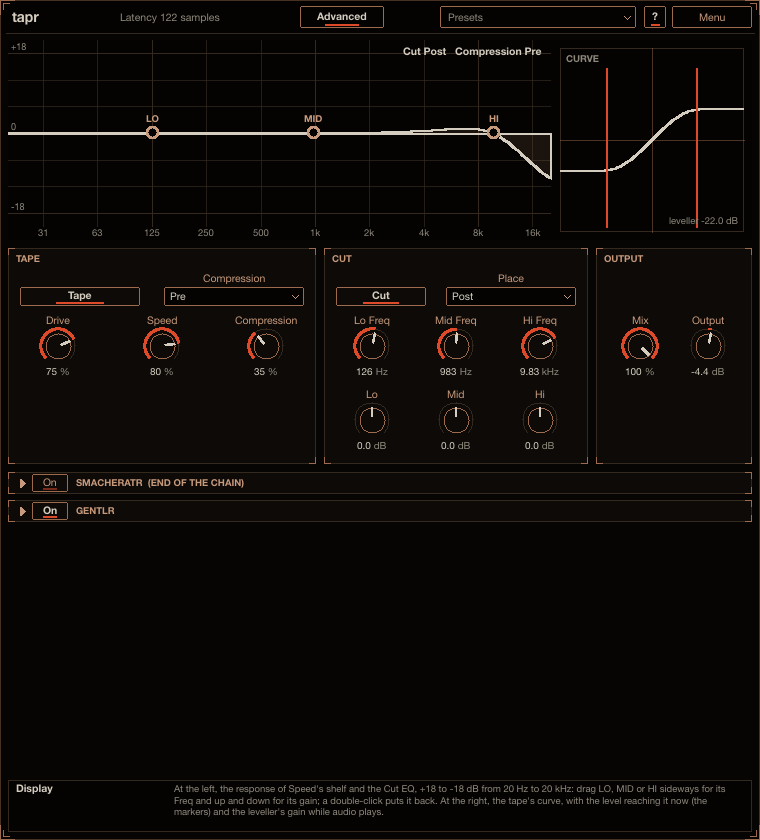

# tapr

tapr is a tape saturator: **Drive** into a fast leveller and a clipper that holds the level, then a softer
top as the tape **Speed** comes down, and a three-band **Cut** EQ. The leveller and the EQ can each sit
before or after the saturation. It is the tape stage of [sweepr](../sweepr/README.md) on its own, with
the EQ and the two placements added. Install instructions are in the [top-level README](../../README.md).



## How to use it

1. Put tapr on a bass, a drum bus or a synth and press play. A new instance is the tape at **Drive**
   75 %, **Speed** 80 %, **Compression** 35 %: thick odd harmonics at a steady level.
2. Turn **Drive** for how hard the tape is pushed: clean and quieter at the bottom, saturated and held
   from about a third up. There is no makeup gain, so more drive is louder until it saturates.
3. **Compression** sets how much the leveller holds the level. **Pre** (before the curve, the classic
   tape): more is softer, quieter and cleaner, and at 0 a high **Drive** clips a sine to a square wave.
   **Post** (after the curve): the curve stays as hard and the leveller rides the result down.
4. **Speed** lower for a darker tape (a high shelf after the curve).
5. Shape it with **Cut**: **Lo**, **Mid** and **Hi**, after the tape (**Post**) to colour the saturated
   sound, or before it (**Pre**) so a boost saturates first and a cut stays cleaner. Drag **LO**, **MID**
   and **HI** on the display too.
6. **Mix** blends in the dry sound, **Output** sets the level.

Point at any control for help in the info box at the bottom (**?** also switches on hover tooltips).

## The display

- At the left, the response of **Speed**'s shelf (with **Tape** on) and the three **Cut** bells (with
  **Cut** on), +18 to -18 dB from 20 Hz to 20 kHz. Drag **LO**, **MID** or **HI** up and down for its
  gain; a double-click (or a right click) puts it back at 0 dB.
- At the right, the tape's curve, with two markers at the level reaching it while audio plays, and the
  leveller's gain.
- At the top, where the leveller and the EQ sit (**Pre** or **Post**).

## Controls

**TAPE**

- **Tape** (on by default): the tape stage. Off, only the **Cut** EQ shapes the sound. Switching it fades
  over 10 ms.
- **Drive** (0 to 100 %, 75 % by default): the gain into the curve, -10 dB to +50 dB.
- **Speed** (0 to 100 %, 80 % by default): the tape speed, a high shelf after the curve: at 100 % almost
  flat (-2 dB at the very top, a little lift around 10 kHz), at 80 % -10 dB from about 15 kHz, at 0 %
  -48 dB above 2 kHz.
- **Compression** (0 to 100 %, 35 % by default): the leveller (2 ms attack, 21 ms release): the higher,
  the lower it holds the level.
- **Comp** (**Pre** by default): where the leveller sits, **Pre** (before the curve) or **Post** (after it).

**CUT**

- **Cut** (on by default): the three bells. At 0 dB each does nothing.
- **Lo** (-18 to +18 dB, 0 by default): a broad bell (Q 1) at 126 Hz.
- **Mid**: at 983 Hz.
- **Hi**: at 9.8 kHz.
- **Place** (**Post** by default): the EQ after the tape (**Post**) or before it (**Pre**).

**OUTPUT**

- **Mix** (100 % by default): the effect against the untouched input, kept in time with each other (no
  comb filtering).
- **Output** (-24 to +12 dB, -4.4 dB by default): the overall level.

**smacheratr** (bottom panel): the saturator every plug-in here ends with. In tapr it starts **off**,
since the tape is the saturator; switch it on for more (its gentlr is on, ready).

The **Basic** page has the display, **Drive**, **Speed**, **Compression**, **Lo**, **Mid** and **Hi**,
**Mix** and **Output**; **Advanced** shows everything.

## How it works

```
input -> [Cut, Pre] -> 4x up -> Drive -> [leveller, Pre] -> clipper -> [leveller, Post] -> 4x down
      -> DC blocker -> Speed's shelf -> [Cut, Post] -> Mix (with the input, delayed as much) -> Output
      -> smacheratr (off by default)
```

**The tape** is a classic tape saturation, measured knob by knob (sines from -72 to 0 dBFS, noise and
level steps) and matched: the gain and the odd harmonics of a 100 Hz sine within about 1 dB at every level
and setting measured. **Drive** is a gain of -10 to +50 dB; the leveller is a peak follower on both
channels together (2 ms attack, 21 ms release) and a gain of 1 / (1 + 3.21 x **Compression** x the
level); the clipper follows a sine up to its top, then stays flat at half of full scale (slope 1 at 0,
odd harmonics, a hint of even ones at about -60 dB), anti-aliased with its antiderivative at four times
the sample rate. **Speed**'s shelf is a second-order high shelf fitted at 18 positions of the knob. The
shapes are in sweepr's `src/core/TapeShape.h`, shared by both plug-ins.

**The Cut EQ** is three fixed bells, measured the same way and matched to within a few thousandths of a
dB: Q 1 at 126 Hz, 983 Hz and 9.8 kHz, a boost and the cut of the same size exact mirrors, at the sample
rate (`src/core/CutShape.h`).

## Presets

The **Presets** menu in the header starts with **Init** (every control at its default) and has these
factory presets: *Tape*: Default, Hot Tape, Soft Tape, Square Clip, Bus Glue; *Cut*: Warm Body, Mid Grit,
Telephone. Save your own with **Save As...**, and use **Save as Default** to make every new tapr start
from the current settings. The menu is described in the [top-level README](../../README.md#presets).

## Latency

tapr's own latency is constant whatever the settings: the oversampling's filters, 37 samples at 48 kHz.
smacheratr at the end adds its own (85 samples at 48 kHz at its default 4x Oversampling, also while it is
off). The host is told and compensates.

## CPU

The defaults take about 1 % of one core at 48 kHz stereo, about 2 % with smacheratr at the end on.
